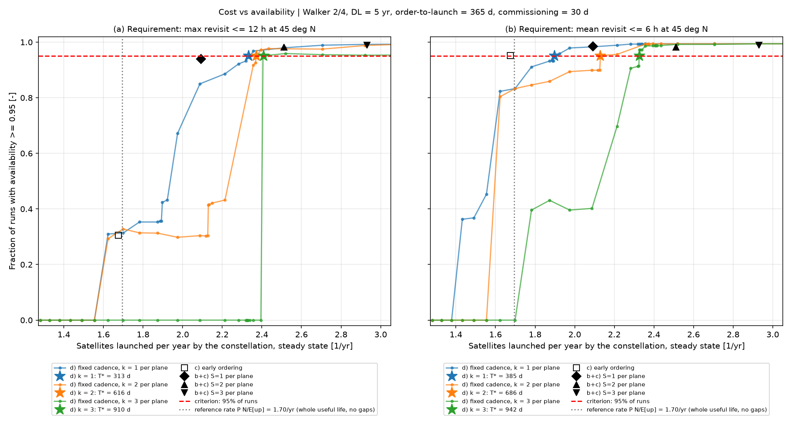
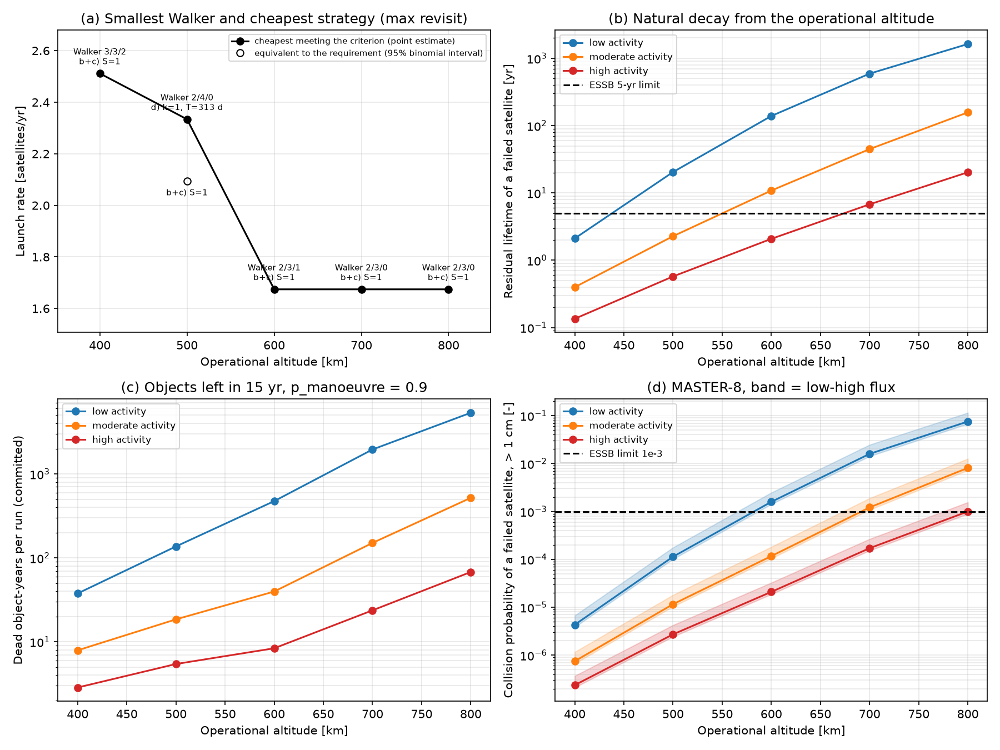
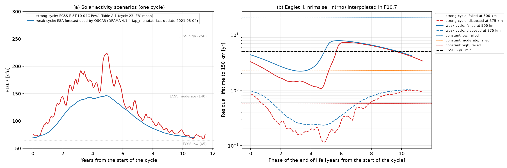

# Constellation Lifecycle Simulator

Monte Carlo simulator of the lifecycle of a small LEO Earth-observation constellation
(deployment, failures, replacements, spares, launch cadence) together with the debris side of the
same decisions: orbital lifetime with the solar cycle, the ESA 5-year rule, collision probability
with MASTER-8 fluxes and on-ground casualty risk with DRAMA SARA.

Reference scenario: a Walker constellation of 25 kg satellites at 500 km in sun-synchronous orbit,
inspired by the IRIDE Eaglet II constellation (reconstructed from public TLEs).

The question behind it: **which replacement strategy meets a revisit requirement at the lowest
cost, and what does each strategy leave in orbit and on the ground?**

Python (numpy, scipy, matplotlib), 125 tests. Every model comes from a physical principle or a
cited source; every parameter in `params.py` has its source or is marked `ASSUMPTION`.

---

## Quick start

```bash
python3 -m venv .venv
source .venv/bin/activate
pip install -r requirements.txt

python main.py            # fast mode, about 5 min, approximate numbers
pytest                    # about 1 min
```

| Command | What it runs | Time* |
|---|---|---|
| `python main.py` | fast mode: 200 Monte Carlo runs, numbers **approximate** | 5.1 min |
| `python main.py --full` | numbers of the report: 1000 runs + T\* check with seeds 42-44 | 14.6 min |
| `python main.py --reliability` | + sensitivity to small-satellite reliability | 11.8 min |
| `python main.py --trade` | + altitude trade-off 400-800 km | 15.9 min |
| `python main.py --full --reliability` | | 28.1 min |
| `python main.py --full --trade` | | 38.8 min |
| `pytest -m slow` | full run with all external files missing (smoke test) | ~5 min |

\* Measured on a laptop, Python 3.15.2, with the coverage cache in `data/` (tracked in the repo;
without it the coverage tables are rebuilt once, 20-30 min more). Figures are written to
`figures/`.

**External files (optional).** Some comparison cases read outputs of ESA's DRAMA 4.1.4 at run time
(OSCAR and SARA runs, the solar-activity forecast and the population density file). They are never
copied into this repository. If they are missing, those cases are skipped with a message and
everything else runs.

---

## What it does

| Module | Content |
|---|---|
| `reliability.py` | Weibull failure times (Castet & Saleh 2009, satellite level, infant mortality) |
| `lifecycle.py` | Monte Carlo of each plane, 1-day step: deployment in batches, launch failures, retirement at design life, four strategies |
| `coverage.py` | Walker SSO coverage with J2, revisit time at 45° N, sizing of the constellation |
| `search.py` | Largest launch interval T\* that meets the requirement (sweep + bisection) |
| `analytic.py` | Analytical references: renewal-reward, birth-death Markov chain, binomial intervals |
| `planes.py`, `tle.py` | Orbital planes of the real IRIDE Eaglet II constellation from TLEs |
| `decay.py` | Drag decay (energy balance, closed form per density band), ECSS-E-ST-10-04C densities, time-varying solar activity |
| `debris.py` | End of life, 5-year rule (ESSB-ST-U-007), dead object-years, collision probability with MASTER-8 |
| `casualty.py` | Casualty area, latitude-weighted population density, cumulative ground risk of the constellation |
| `launch_log.py` | Launch success probability from the GCAT launch log (Jeffreys interval) |

Replacement strategies compared: **a)** launch on failure, **b)** in-orbit spares, **c)** early
ordering of the replacement before retirement, **b+c**, **d)** fixed launch cadence.
Requirements: max revisit ≤ 12 h or mean revisit ≤ 6 h at 45° N, met with availability ≥ 0.95 in
at least 95% of the runs.

---

## Main results

**1. The requirement chooses the strategy.** At 500 km (Walker 2/4/0), with the max-revisit
requirement the fixed cadence d) (one satellite per plane every 313 days) and b+c with one spare
per plane are statistically tied, so there is no single winner. With the mean-revisit requirement,
early ordering c) is the cheapest (1.674 satellites/yr). With the small-satellite reliability of
Dubos et al. the cheapest option changes where the margins were thin (mean requirement: c) fails,
d) costs +16%).



**2. 500 km is the compromise.** Going up needs fewer satellites (-28% from 500 to 600 km), but from
600 km a failed satellite breaks the 5-year rule even with moderate solar activity and the collision
probability exceeds 10⁻³ with low activity. 500 km is also the real altitude of Eaglet II.



**3. The 5-year rule depends on when the satellite fails.** With the solar cycle, a satellite that
fails at 500 km stays 3.8 years on average with the ECSS cycle 23 and 4.8 years with the 2021 ESA
forecast, but only 54-66% of the end-of-life phases are compliant: failing on the way down to the
solar minimum breaks the rule.



**4. Ground risk adds up.** One uncontrolled re-entry meets the ESA limit with a large margin
(E_c = 0 if everything demises, 1.4·10⁻⁵ if the titanium tank and the optics survive, DRAMA SARA).
Over 15 years the constellation re-enters 17-50 satellites, i.e. 2-7·10⁻⁴ expected casualties
depending on the strategy. The ESA limits are per re-entry only; the fixed cadence roughly doubles
the cumulative risk compared with launch on failure.

---

## Validation

- **Every module has tests** against analytical or reference cases (125 tests): Monte Carlo
  survival vs analytical R(t), renewal-reward and Markov-chain availability, closed-form decay vs
  numerical integration, Cauchy mean cross-section, binomial intervals.
- **Orbital decay vs DRAMA/OSCAR**, three runs on the Sentinel-3B tutorial case with the same solar
  input (constant, ECSS cycle 23, observed indices). Not tuned: our model decays faster, by 19-37% in
  lifetime, which is only **+9 to +15 km in equivalent disposal altitude**. OSCAR's Δv and propellant
  are reproduced within 0.01 m/s and 0.02 kg.
- **Casualty risk vs DRAMA/SARA**: casualty areas reproduced to the last digit; our independent
  latitude weighting of the population gives the same effective density (12.46 people/km²) and the
  same E_c to 10⁻⁸.
- **Decay rate vs real data**: 15 of the 16 IRIDE Eaglet II satellites decay at 49-121 m/day,
  on the moderate-activity curve of the model.

---

## Limits

- Lifecycle: planes are independent, revisit from a lookup table (quasi-stationary), no
  station-keeping propellant, instantaneous disposal manoeuvre.
- Reliability: Weibull fits of satellites up to 500 kg; satellites of 25 kg are probably less
  reliable still.
- Decay: circular orbits, ECSS tables averaged in latitude and local time, monthly solar indices;
  remaining gap to OSCAR of 9-15 km (Earth oblateness is a likely contributor, not verified).
- Casualty risk: 1D projection (no longitude, no ground dispersion), two assumed inventories of the
  satellite (no public internal layout).

## Future work

- Spares stored in parking orbits, using the differential J2 drift of the RAAN.
- Optical detection model of dead satellites (apparent magnitude).
- Revisit with the real in-plane phases of IRIDE.

---

## Main sources

- J.-F. Castet, J. H. Saleh, *Satellite and satellite subsystems reliability*, RESS 94 (2009).
- G. F. Dubos, J.-F. Castet, J. H. Saleh, *Statistical reliability analysis of satellites by mass
  category*, IAC-09-D1.3.6 (2009).
- ECSS-E-ST-10-04C Rev.1, *Space environment* (2020): density tables (Annex G), solar cycle 23 (Table A-1).
- ESA, *Space Debris Mitigation Requirements*, ESSB-ST-U-007 Issue 1 Rev 0 (2023).
- ESA DRAMA 4.1.4 (OSCAR, SARA) and MASTER-8: runs made by the author, outputs read at run time.
- NASA ODPO, Debris Assessment Software; NASA-STD-8719.14 (casualty area).
- J. McDowell, GCAT launch log; CelesTrak TLEs (only the derived elements are in `inputs/`).
- ASI, IRIDE programme page (Eaglet II launches).

---

Michele Ramalli, MSc Space Engineering, Politecnico di Milano.
